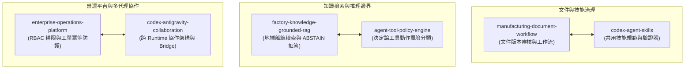

# 技術能力作品集｜展示與驗證索引 (Showcase Hub)

歡迎瀏覽本技術作品集。本作品集旨在展示本人在 **AI Agent 架構、Multi-Agent 協作、企業系統整合、RAG 檢索增強、工具安全策略與驗證導向工程 (Verification-driven Engineering)** 的實際工程能力。

所有展示內容均秉持**誠實工程原則**：明確區分「已實測通過」、「局部驗證 (PARTIAL)」、「環境受阻 (LIVE_BLOCKED)」與「尚未驗證 (NOT_VERIFIED)」，不把架構藍圖或 Mock 宣稱為正式生產驗收。私有開發倉庫保留獨立開發，本公開作品集一律採用經過資安去敏審查之合成資料與授權副本。

---

## 專案架構全景與狀態矩陣 (Status Matrix)

| 子專案 | 核心技術領域 | 來源類型 | 驗證等級 / 現況標籤 | 核心展示價值與邊界 |
|---|---|---|---|---|
| **[1. 製程文件版本審核與 AI 輔助工作流](./manufacturing-document-workflow/)** | 文件治理 · Claude Skill · 審核閘門 | Public 倉庫 | **Claude Free 實測** (T1 PASS / T2 FAIL / T3 PASS) | 包含新版流程、跨客戶越權攔截、沙盒 PoC；保留 Skill 載入截圖證據；明確宣告 SharePoint API 未連線。 |
| **2. 工廠設備知識庫與地端診斷 RAG** *(Batch 2 匯入)* | RAG 檢索 · Citation · 衝突識別 | Private 倉庫 | **Local Benchmark PASS** (離線可跑 · 預設唯讀) | 離線 Qdrant / BM25 檢索、證據引用、ABSTAIN 拒答保護；僅含合成設備手冊，**不散布 8 份真實 OEM 原檔**。 |
| **3. 企業營運平台垂直切片** *(Batch 2 匯入)* | 系統架構 · RBAC · 工單防護 | Private 倉庫 | **PR #2 MERGED (UX-02)** (合成資料小型切片) | 角色權限狀態機、401/403 攔截、工單重試與冪等防護；零連線字串、零真實員工/設備資料。 |
| **4. Agent 工具策略引擎** *(Batch 2 匯入)* | 安全架構 · 策略評估 · 決定論 | Private 倉庫 | **24 單元測試 PASS** (0 外部相依 · Staging) | 結構化 side-effect 分類、TOML 策略比對、fail-closed 防護；明示為 staging preflight，非已部署 Gateway。 |
| **[5. Codex × Antigravity 協作架構](./codex-antigravity-collaboration/)** | Multi-Agent · Runtime 邊界 · 協議 | Public 倉庫 | **LIVE_BLOCKED** (Mock 通訊 PASS · 人工閘門) | Bounded Task/Result 規範、Local Bridge 檔案鎖定；保留受限標籤，不宣稱全自動背景雙向即時交接。 |
| **[6. Codex Agent Skills 技能庫](./codex-agent-skills/)** | Skill 規範 · 自動化驗證 · 流程 | Public 倉庫 | **驗證腳本 PASS** (單一標準規範源) | 結構化 Skill 定義、自動格式檢驗腳本 (`validate.ps1`)；與文件工作流共享規範，杜絕雙頭漂移。 |

---

## 六大能力維度對照

1. **可攜式 Skill 與流程自動化**：由 `manufacturing-document-workflow` 與 `codex-agent-skills` 示範如何在受限推理環境中，透過格式約束引導安全行為。
2. **證據導向的檢索與防護**：由 `factory-knowledge-grounded-rag` 與 `agent-tool-policy-engine` 示範「無證據即拒答 (ABSTAIN)」與「不把 Prompt 當安全邊界 (Fail-closed)」。
3. **平台可靠性與多代理分工**：由 `enterprise-operations-platform` 與 `codex-antigravity-collaboration` 示範在多角色與多 Runtime 環境下，如何保持狀態機一致與寫入隔離。

---

## 交付與審查合約 (Delivery Contract)

- **無資料洩漏**：本倉庫絕不包含任何 API Token、真實連線字串、未授權原廠 PDF、本機絕對路徑或內部人員個資。
- **無強制自動合併**：所有子專案與主倉庫更新一律透過 GitHub Draft PR 提交，並經由嚴格的人工審查 Gate (Human-in-the-loop) 進行驗收。
- **分支與版本鎖定**：每個子專案均具備獨立之 `PROVENANCE.md`，清楚標示來源 Commit SHA 與同步依據。
