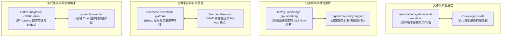
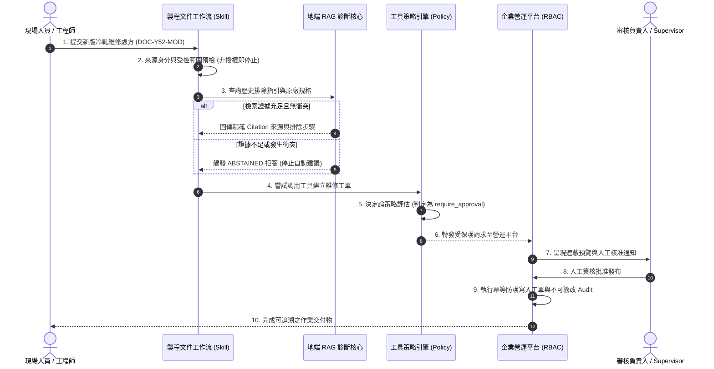

# 技術能力作品集｜展示與驗證索引 (Showcase Hub)

歡迎瀏覽本技術作品集。本作品集旨在展示本人在 **AI Agent 架構、Multi-Agent 協作、企業系統整合、RAG 檢索增強、工具安全策略與驗證導向工程 (Verification-driven Engineering)** 的實際工程能力。

所有展示內容均秉持**誠實工程原則**：明確區分「已實測通過」、「局部驗證 (PARTIAL)」、「環境受阻 (LIVE_BLOCKED / OCI_CAPACITY_WAIT)」與「尚未驗證 (NOT_VERIFIED)」，不把架構藍圖或 Mock 宣稱為正式生產驗收。私有開發倉庫保留獨立開發，本公開作品集一律採用經過資安去敏審查之合成資料與授權副本。

---

## 專案架構全景與狀態矩陣 (Status Matrix)

| 子專案 | 核心技術領域 | 來源類型 | 驗證等級 / 現況標籤 | 核心展示價值與邊界 |
|---|---|---|---|---|
| **[1. 製程文件版本審核與 AI 輔助工作流](./manufacturing-document-workflow/)** | 文件治理 · Claude Skill · 審核閘門 | Public 倉庫 | **Claude Free 實測** (T1 PASS / T2 FAIL / T3 PASS) | 包含新版流程、跨客戶越權攔截、沙盒 PoC；保留 Skill 載入截圖證據；明確宣告 SharePoint API 未連線。 |
| **[2. 工廠設備知識庫與地端診斷 RAG](./factory-knowledge-grounded-rag/)** | RAG 檢索 · Citation · 衝突識別 | Private 倉庫 | **Local Benchmark PASS** (離線可跑 · 預設唯讀) | 離線 Qdrant / BM25 檢索、證據引用、ABSTAIN 拒答保護；僅含合成設備手冊，**不散布 8 份真實 OEM 原檔**。 |
| **[3. 企業營運平台垂直切片](./enterprise-operations-platform/)** | 系統架構 · RBAC · 工單防護 | Private 倉庫 | **22/22 測試 PASS** (合成資料小型切片) | 角色權限狀態機、401/403 攔截、工單重試與冪等防護；零連線字串、零真實員工/設備資料。 |
| **[4. Agent 工具策略引擎](./agent-tool-policy-engine/)** | 安全架構 · 策略評估 · 決定論 | Private 倉庫 | **24 單元測試 PASS** (0 外部相依 · Staging) | 結構化 side-effect 分類、TOML 策略比對、fail-closed 防護；明示為 staging preflight，非已部署 Gateway。 |
| **[5. Codex × Antigravity 協作架構](./codex-antigravity-collaboration/)** | Multi-Agent · Runtime 邊界 · 協議 | Public 倉庫 | **LIVE_BLOCKED** (Mock 通訊 PASS · 人工閘門) | Bounded Task/Result 規範、Local Bridge 檔案鎖定；保留受限標籤，不宣稱全自動背景雙向即時交接。 |
| **[6. Codex Agent Skills 技能庫](./codex-agent-skills/)** | Skill 規範 · 自動化驗證 · 流程 | Public 倉庫 | **驗證腳本 PASS** (單一標準規範源) | 結構化 Skill 定義、自動格式檢驗腳本 (`validate.ps1`)；與文件工作流共享規範，杜絕雙頭漂移。 |
| **[7. Paperclip AI Chief 雲端自主 Agent 團隊](./paperclip-ai-chief/)** | 雲端 Agent · 組織審批 · 零額外月費 | Private 倉庫 | **Local Loop PASS / OCI_CAPACITY_WAIT** (本機驗證通過 · 雲端容量等待) | Chief/Research/Reviewer 任務閉環、Codex CLI Heartbeat、Gemini Adapter；Oracle Tokyo VM 免費容量受阻，Fail-Closed 止損。 |
| **[8. LINE Portable Core 可移植通訊與 Mini App 核心](./line-portable-core/)** | 通訊協議 · 冪等防重放 · LIFF | Private 倉庫 | **16 單元測試 PASS** (真機 E2E 0/4 待驗證) | HMAC-SHA256 簽署驗證、webhookEventId 冪等去重、shareTargetPicker 狀態校驗；誠實標記手機真機連線待驗收。 |

---

## 八大能力維度對照

1. **可攜式 Skill 與流程自動化**：由 `manufacturing-document-workflow` 與 `codex-agent-skills` 示範如何在受限推理環境中，透過格式約束引導安全行為。
2. **證據導向的檢索與防護**：由 `factory-knowledge-grounded-rag` 與 `agent-tool-policy-engine` 示範「無證據即拒答 (ABSTAIN)」與「不把 Prompt 當安全邊界 (Fail-closed)」。
3. **平台可靠性與通訊安全**：由 `enterprise-operations-platform` 與 `line-portable-core` 示範狀態機一致性、401/403 攔截、HMAC 簽名校驗與 Webhook 冪等防重放。
4. **多代理組織與雲端自治**：由 `codex-antigravity-collaboration` 與 `paperclip-ai-chief` 示範雙 Runtime 隔離協作、原生審批防線 (`requireBoardApprovalForNewAgents`) 與零額外月費的雲端自動巡查。

---

## 跨專案合成資料端到端演示 (Cross-Project Synthetic E2E Walkthrough)

> [!NOTE]
> 本演示為**架構與驗證流程串連展示**。本流程全數採用合成假想情境與非機密資料，不強制要求建立單一巨型資料庫，亦不隱含對真實產線 PLC 或企業 SharePoint 之直接寫入。

### 演示階段細節與驗證對照

1. **文件事件與存取閘門**（參閱 [`manufacturing-document-workflow`](./manufacturing-document-workflow/)）：
   - 觸發：收到合成機台變更報告，先依身分邊界檢查租戶與文件 Owner 範圍。
   - 安全邊界：如發生跨客戶或未授權存取要求，模型立即停止推論（重現 T2 越權攔截機制）。
2. **地端離線檢索與嚴格引用**（參閱 [`factory-knowledge-grounded-rag`](./factory-knowledge-grounded-rag/)）：
   - 檢索：完全離線執行 Qdrant / BM25 檢索，比對假想手冊 `DOC-Y52-ALARM-001.md`。
   - 邊界防護：嚴格遵循「No unsupported actionable claim reaches the user」；若語料庫中無對應手冊支持，直接輸出 `ABSTAINED`，嚴禁虛構操作步驟。
3. **工具動作決定論風險分類**（參閱 [`agent-tool-policy-engine`](./agent-tool-policy-engine/)）：
   - 評估：評估核心接收 Tool-call 請求，正規化路徑與動作類型。
   - 決策：偵測到對工作區外的寫入或涉及系統狀態變更，自動將決策降級為 `require_approval`，杜絕 Prompt Injection 繞過。
4. **營運平台工單狀態機與防護**（參閱 [`enterprise-operations-platform`](./enterprise-operations-platform/)）：
   - RBAC 控制：檢查操作者是否具備主管權限，非授權存取即時返回 403 Forbidden。
   - 冪等防護：工單建立流程具備重試去重機制，防範網路抖動造成重複開單。
5. **多代理交接與回歸審查**（參閱 [`codex-antigravity-collaboration`](./codex-antigravity-collaboration/) 與 [`codex-agent-skills`](./codex-agent-skills/)）：
   - 協作模式：Antigravity 負責總控分析，Codex 負責獨立實作，雙方透過 Bounded Task/Result 交換驗證結果。
   - 規範收斂：所有交付物格式依據 `output-contract` 規範輸出，並通過 `validate.ps1` 自動檢驗。
6. **雲端自主營運與跨平台整合**（參閱 [`paperclip-ai-chief`](./paperclip-ai-chief/) 與 [`line-portable-core`](./line-portable-core/)）：
   - 雲端排程：以零額外月費之 ARM64 雲端主機配置每日巡查，遇到容量限制時自動 fail-closed 停止重試。
   - 對外通訊：以輕量 HMAC-SHA256 驗證防禦偽造 Webhook，確保 Mini App 分享狀態解析無誤。
