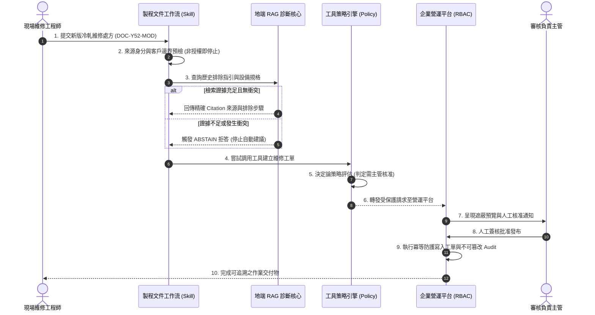

# 技術能力作品集 (Engineering Capabilities Showcase)

具備製造業現場經驗，專注將現場製程文件、設備手冊知識與營運工單流程，落地為高可靠、具備安全防護與可驗證的 AI Agent 與企業系統。

所有展示均區分已完成測試、局部驗證與環境邊界；私有來源倉庫保留獨立開發，本公開作品集採用經資安審查之合成資料與授權副本。

---

## 核心展示專案 (Featured Projects)

### 1. 工廠設備知識庫與地端診斷 RAG ([`factory-knowledge-grounded-rag/`](./factory-knowledge-grounded-rag/))
- **現場問題**：維修人員詢問設備警報處理時，一般 LLM 容易產生幻覺，捏造未授權的操作步驟。
- **架構做法**：離線混合檢索 (Qdrant + BM25)、強制手冊 Citation 來源標記，並設計 5 道確定性檢查閘門，落實「查無證據即拒答 (ABSTAIN)」。
- **驗證數據**：25 題基準測試 100% 安全合規，0 次捏造操作建議。
- **展示邊界**：使用自編冷軋設備手冊測試，不外洩真實工廠 OEM 原廠手冊。

### 2. 製程文件版本審核與 AI 工作流 ([`manufacturing-document-workflow/`](./manufacturing-document-workflow/))
- **現場問題**：產線處方修改責任不清，跨客戶資料容易因 Prompt 缺陷產生越權洩漏。
- **架構做法**：在受限推理環境 (Claude Free) 下設計結構化 Skill 約束模型行為，建立跨客戶隔離與審查流程。
- **驗證數據**：實測成功攔截跨客戶越權存取（T1 格式通過；T2 原版完整性不足，修正後重測通過；T3 依賴查核通過）。
- **展示邊界**：定位為 Skill 規範與沙盒 PoC 驗證，未連線企業 SharePoint API。

### 3. 企業營運平台垂直切片 ([`enterprise-operations-platform/`](./enterprise-operations-platform/))
- **現場問題**：產線工單容易在網路不穩時重複提交，後台缺乏嚴格的角色權限狀態機。
- **架構做法**：採用 ASP.NET Core 10 (.NET 10) 現代後端架構，實作 RBAC 權限狀態機與工單冪等防重試機制。
- **驗證數據**：22 項單元與整合測試全數通過 (1 Skip)，涵蓋 401/403 攔截與資料回滾驗證。
- **展示邊界**：採用小型合成切片展示，排除真實員工資料與生產資料庫連線字串。

### 4. Agent 工具策略引擎 ([`agent-tool-policy-engine/`](./agent-tool-policy-engine/))
- **現場問題**：AI Agent 自主調用本機或雲端工具時，容易被 Prompt Injection 誘騙而寫入非預期目錄或執行危險指令。
- **架構做法**：純 Python 零外部依賴，以決定論策略在工具調用前預檢副作用風險，預設採 Fail-Closed 防護。
- **驗證數據**：24 項單元測試全數通過，跨 Windows / Linux / macOS 跨平台 CI 通過。
- **展示邊界**：定位為工具調用前置檢驗核心 (Preflight)，非已上線之獨立 Gateway。

---

## 跨專案端到端情境走查 (Cross-Project E2E Walkthrough)

以冷軋機 Y52 設備異常維修為情境，串連各專案的防護機制：

---

## 延伸實作與架構探索 (Additional Projects)

除核心專案外，亦包含以下延伸探索與實用工具：

- **[Codex × Antigravity 協作架構](./codex-antigravity-collaboration/)**：
  異質 Agent 跨 Runtime 邊界協議，採用 Bounded Task/Result 規範與 Local Bridge 檔案鎖。（現狀：架構協議確立；跨 Runtime 即時連線受限，採本地檔案橋接）。
- **[LINE Portable Core 通訊核心](./line-portable-core/)**：
  Hexagonal 架構，實作 Webhook HMAC-SHA256 簽名驗證、`webhookEventId` 冪等防重放，以及 LIFF `shareTargetPicker` 容錯。（現狀：16 項單元測試全數通過；手機真機測試 4 項需待設定 LINE 官方帳號）。
- **[Paperclip AI Chief 雲端自主團隊](./paperclip-ai-chief/)**：
  以 NT$0 額外費用為目標，設計 Chief / Research / Reviewer 三角色任務閉環、Codex CLI 心跳巡查與 ARM64 Docker Compose 規格。（現狀：本機任務閉環驗證通過；Oracle 東京免費 ARM 主機額度已滿，雲端部署待資源釋出）。
- **[可攜式 AI Agent 環境](../portable-ai-agent-environment/)**：
  解決更換電腦無法直接複製憑證與絕對路徑之痛點；提供 Bash 暫存檔敏感資料掃描器與回歸測試。
- **[製造業智慧排班系統設計](../workforce-scheduling-system/)**：
  連續生產（四班二輪）排班規格設計案例，定義勞基法法規與工時顯式約束。
- **[html2slides](../html2slides/)**：
  將 HTML 投影片轉換為可編輯 PowerPoint (.pptx) 與 Google Slides 的轉換工具。
- **[Codex Agent Skills 技能庫](../codex-agent-skills/)**：
  結構化 Skill 定義規範，提供自動化檢驗腳本 (`validate.ps1`) 防止格式漂移。
