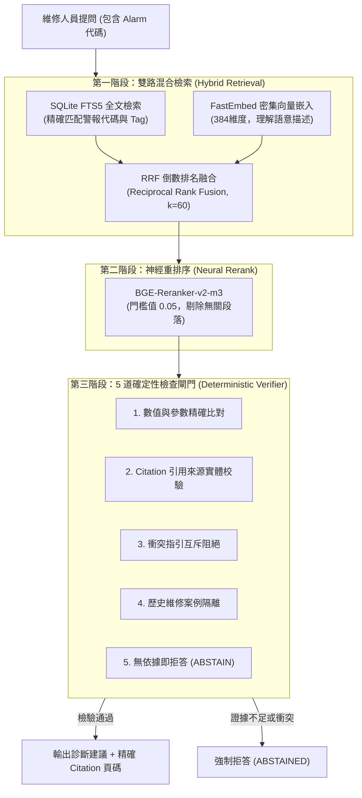

# 工廠設備知識庫與地端診斷助手 (Factory Knowledge Grounded RAG)

> **核心安全性準則**：  
> **No unsupported actionable claim reaches the user.**  
> （沒有手冊來源支持的可執行操作建議，系統必須堅決拒答，嚴禁捏造。）

本專案是一個 **Local-First、完全可離線執行** 的工廠設備知識庫與診斷助手系統。專為高安全要求的製造業產線設計，結合語意檢索、全文搜尋與確定性檢查閘門，解決 LLM 在工廠維修場景中產生幻覺操作的嚴重隱患。

---

## 1. 核心痛點與設計架構

在製造業產線設備維修中，一般通用 RAG 面臨兩大挑戰：
1. **幻覺代價極高**：如果 AI 瞎掰了一個螺絲扭力值或氣壓參數，現場人員照做可能導致機台損毀或工安意外。
2. **專有名詞比對失準**：一般向量檢索對於機台警報代碼（如 `ALM-Y52-04`）、感測器 Tag 缺乏精確命中能力。

### 解決方案：混合檢索 + 5 道確定性防幻覺檢查閘門



---

## 2. 模組架構與技術選型

- **文件結構化解析**：Docling 解析器，支援技術手冊轉換為結構化 Markdown 表格與階層。
- **雙路混合檢索**：
  - 語意檢索：FastEmbed (`paraphrase-multilingual-MiniLM-L12-v2`) + Qdrant Local 本地向量庫。
  - 全文檢索：SQLite FTS5，精確檢索警報代號與機台部位。
  - 融合排序：RRF (Reciprocal Rank Fusion)。
- **神經重排序**：`BAAI/bge-reranker-v2-m3`，針對候選段落精確打分。
- **確定性檢查閘門**：`core/verifier.py`，純 Python 決定論規則引擎，不受 Prompt Injection 影響。

---

## 3. 評測基準與測試結果

在 12 份自編冷軋設備手冊合成語料庫與 25 題典型設備故障診斷題集下：

- **安全合規率**：**25/25 (100%)**
- **非事實建議輸出**：**0 次**
- **無證據或衝突情境**：精確觸發 `ABSTAINED` 拒答，阻止危險操作建議輸出。
- **本地重現指令**：

  **1. 快速核心與安全合約測試（無需外部模型依賴，23 項全過，約 1.6 秒）**：
  ```bash
  # 驗證介面合約、配置 Profile、分塊演算法、RRF 融合與 5 道確定性防幻覺檢查閘門
  pytest tests/test_v3_contracts.py tests/test_mvp0_core.py tests/test_sprint1_identity.py tests/test_sprint1_chunking.py tests/test_sprint2_rrf.py tests/test_sprint3_negative_safety.py -v
  ```

  **2. 全量模型與端到端評測（需安裝 torch、docling、fastembed 等選用依賴）**：
  ```bash
  pip install -r requirements.txt
  pytest tests/ -v
  ```

---

## 4. 安全與邊界說明
- 本展示切片全數使用自編合成設備手冊與開放語料，不公開或散布廠內 8 份真實 OEM 原廠 PDF。
- 系統設計為唯讀診斷輔助，未直連產線 PLC / SCADA 網路。
