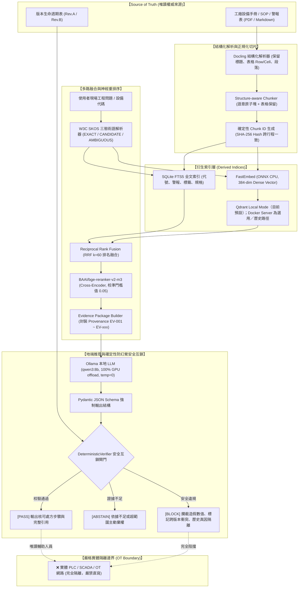

# Factory Knowledge Grounded RAG — V3 System Architecture

> 文件狀態：歷史／參考；目前開發預設為 Qdrant Local Mode。此文件保留舊版 Docker Server 證據；Qdrant Docker／具名 Volume 是選用或歷史路徑，不是 Local Mode 的啟動前提，不得因閱讀本文件而啟動或操作受保護 Volume。

> **核心安全性準則 (Core Safety Principle)**：  
> **No unsupported actionable claim reaches the user.**  
> （沒有來源支持的可執行工程判斷／操作建議，絕不下發給現場人員。）

---

## 1. 端到端資料流與核心架構圖 (End-to-End Dataflow)

---

## 2. 系統信任與安全邊界 (Trust & Security Boundaries)

### 2.1 權威來源 (Source of Truth) vs 衍生索引 (Derived Index)
- **原始手冊 (Source of Truth)**：永遠以受控版本之 PDF / Markdown 手冊為唯一準則。
- **向量資料庫與全文檢索 (Derived Indices)**：Qdrant 與 SQLite 僅為加速檢索之輔助衍生索引，不可作為獨立於手冊之外的事實來源。

### 2.2 人工審查邊界 (Human Review Boundary)
- 所有未經驗證之影像辨識、新設備知識均歸類為 `candidate`，嚴禁自動晉級為正式權威手冊。
- 歷史維修紀錄僅作為經驗參考，嚴格隔離，禁止 AI 自動升格為當前設備事故之唯一真因。

### 2.3 OT / 產線控制實體隔離 (OT Air-Gap)
- 本診斷系統純屬 **地端唯讀輔助分析工具**。
- 嚴禁透過任何自動化腳本直接對產線 PLC、SCADA 或工業機器人發出寫入或啟動指令。
- 診斷報告必須經由現場持證機電工程師人工確認後，手動於操作面板執行。
