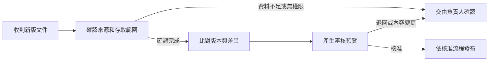

# 製程文件改版審查流程｜Claude Skill 實作

製造現場的文件一改版，通常會同時影響製造、品保、文管和資訊單位。誰負責確認版本？不同部門能看到哪些內容？差異摘要完成後，又該由誰批准發布？

我用一間虛構工廠建立文件改版案例，整理從收到新版、查核來源、比對內容到負責人審核的流程，並把這套工作方法寫成 Claude Skill，在 Claude Free 進行實際問答測試。

## 文件流程怎麼走

流程把文件 Owner、使用部門、IT 和審核負責人的責任分開，讓改版事件不會只剩下一個「請 AI 幫我摘要」的步驟。

## Skill 的兩次設計

第一版涵蓋事件識別、版本檢查、冪等處理、審核、錯誤處理與稽核紀錄。測試後，我針對跨客戶文件的情境補上資料分類、事前授權、限時最小權限與權限再次確認，形成修正版。

- [原版 Skill](skill/workflow-automation-agent/SKILL.md)
- [授權審查修正版 Skill](skill/workflow-automation-agent-access-review/SKILL.md)
- [流程與角色分工](docs/workflow-design.md)

## Claude Free 實測

| 情境 | 觀察結果 |
| --- | --- |
| 一般文件改版 | Claude 能整理版本比對、審核及發布前的檢查流程 |
| 跨客戶文件（原版） | 拒絕越權讀取，但安全替代流程說明不完整 |
| 跨客戶文件（修正版單次重測） | 拒絕略過權限，並補充 Owner 授權、限時權限與發布前確認 |
| 缺少真實文件和 API 權限 | 清楚區分已知條件與假設，將作業限制在合成案例 |

原版測試為 T1、T3 通過，T2 完整性未通過；修正版另有一次 T2 重測通過。兩次 T2 的模型與題目略有差異，這些紀錄用來觀察 Skill 行為，不把單次差異當成改版成效的統計證明。

[查看測試方法與結果](docs/validation.md) · [合成案例](examples/test-cases.md) · [測試文字紀錄](evidence/)

## 如何閱讀這個作品

建議先看流程圖，再開啟兩版 Skill 比較檢查條件的變化，最後對照 Claude 的測試結果。這個作品呈現**流程設計與 Skill 實際使用**；文件、組織與權限情境均為合成，沒有連線真正的 SharePoint 或企業文件系統。
