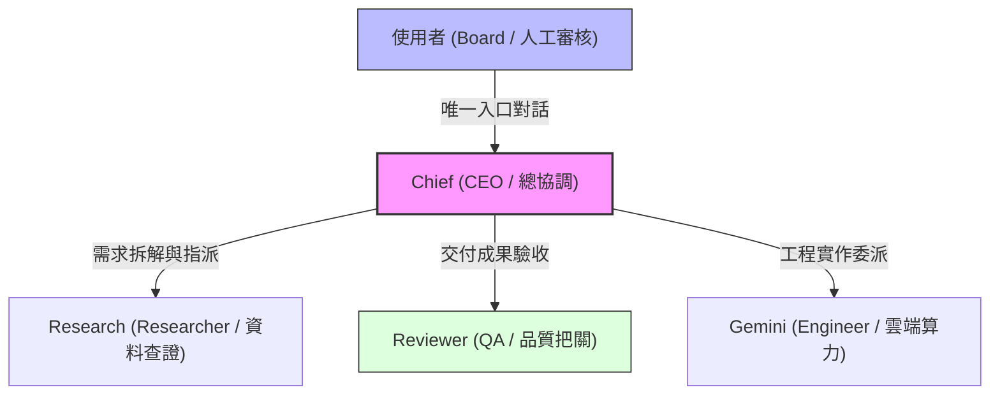

# Paperclip AI Chief｜部署設計與本機驗證

> **專案定位**：以 NT$0 增額月費為目標之多 Agent 團隊架構；以工程防護與實作留痕為核心，不為展示而重造管理平台。  
> **關鍵技術**：Paperclip、Codex CLI (codex_local / ChatGPT Plus)、Oracle Cloud Always Free (ARM64 Ampere A1)、Tailscale 私網防護。  
> **狀態**：本機端到端任務閉環與 Heartbeat 心跳驗證通過；雲端部署規格就緒，Oracle 東京免費主機排隊輪詢中。

---

## 1. 核心痛點與架構目標

在導入多代理（Multi-Agent）系統時，常見三大核心痛點：
1. **API 帳單失控與黑盒調用**：許多框架過度串接多個計費 API，缺少預算防護機制，容易死循環產生高額費用。
2. **依賴本機運行，關機即中斷**：本機執行 Agent 只要電腦休眠即中斷，無法持續執行定時巡查或非同步任務。
3. **缺少嚴謹的資料治理與審批邊界**：Agent 自由增生或未經授權存取機敏資料，缺乏原生的人工審查（Human-in-the-loop）防線。

### 本專案之設計方案
- **NT$0 增額月費目標**：利用既有訂閱之 Codex CLI 作為推論引擎，搭配 Oracle Cloud Always Free ARM64 (Ampere A1) 免費算力，實踐零增額成本運作。
- **單一人機入口與階層協作**：使用者對接 **Chief (CEO)**；由 Chief 拆解目標、指派給專業 Agent（Research、Reviewer、Gemini），並透過看板與留言追蹤進度。
- **嚴格審批與私網防護**：
  - 開啟原生審批防線（`requireBoardApprovalForNewAgents: true`），新 Agent 增聘必須經由人工核准。
  - 雲端環境採用 **Tailscale 私網隧道**，公網完全封鎖 3100 埠與資料庫，達成零暴露面防禦。
  - 資源耗盡時採取 **Fail-Closed**，嚴禁自動改用計費服務或付費實例。

---

## 2. 組織架構與角色分工 (Org Chart)

- **Chief (`role: ceo`)**：統籌全域需求、分解任務、協調相依性、排程巡查與每日進度彙報。
- **Research (`role: researcher`)**：負責外部資訊檢索、一手資料交叉查證與產出事實報告。
- **Reviewer (`role: qa`)**：負責成果驗收、事實比對、格式規範與防回歸審查；未達標準則駁回修改。
- **Gemini (`role: engineer`)**：整合 Google AI Studio 算力資源，提供技術輔助與代碼轉化。

---

## 3. 本機端到端實作與驗證

本專案全數實作成效均具備真實系統驗證與執行依據：

### A. 完整任務閉環流程
本機完成一次 3 個角色的完整任務流程：
1. **需求接收**：Chief 接收冷軋異常分析任務並拆解工作項目。
2. **研究產出**：Research 角色進行資料檢索與標準化報告彙整。
3. **驗收結案**：Reviewer 角色依 Checklist 進行審查並判定通過，交付 Chief 完成結案歸檔。

### B. Codex CLI 原生 Heartbeat 執行
透過本機 ChatGPT Plus 之 Codex CLI 原生調用輸出，成功於 Paperclip 架構內完成自主週期心跳巡查。

### C. Gemini Local Adapter 驗證
確認雙推論引擎（Codex + Gemini）可按需切換與協作。

---

## 4. 雲端部署規格與防護架構

所有雲端部署腳本與配置均收錄於 `deploy/oracle-always-free/`：

1. **容器編排 (`docker-compose.oracle-arm64.yml`)**：
   - 針對 ARM64 (Ampere A1) 架構最佳化。
   - 限制容器資源上限（`cpus: '2.0'`, `memory: 6144M`），防止單一程序耗盡主機。
   - 連接埠僅綁定本機環回介面 (`127.0.0.1:3100:3100`)。
2. **安全安裝腳本 (`install-oracle-vm.sh`)**：
   - 自動配置防火牆，預設封鎖外部公網連線，僅放行 SSH 與 `tailscale0` 虛擬網卡。
   - 自動產生 64 位元安全隨機密鑰 (`BETTER_AUTH_SECRET`)。
3. **排程巡查規格 (`routine-0700-taipei.json`)**：
   - 每日台北時間 07:00 定時觸發 Chief 進行早會巡查，主動通報受阻項目。
4. **安全備份 (`backup-db.sh`)**：
   - 每日自動封裝資料庫，排除任何 `.env`、憑證金鑰或 OAuth Token，自動保留近 7 日循環覆蓋。

---

## 5. 誠實工程限制與現狀

1. **雲端 VM 容量等待**：
   - 已完成專屬虛擬雲端網路 `paperclip-vcn` 與公開子網路建置（Tokyo `ap-tokyo-1` 區域）。
   - 東京區域免費 ARM 主機目前配額已滿；系統已設定定時輪詢腳本排隊等待空額，同時絕不擅自升級為付費實例，實踐零增額費用承諾。
2. **多 Agent 平行 SQLite 鎖保護**：
   - 已在排程設定中將各 Agent 的喚醒時間錯開 5 秒以上，避免資料庫鎖定競爭。
3. **外部整合邊界**：
   - 本專案建立嚴謹的資料分類規範，未連線真實企業 SharePoint 租戶之權限 API。
