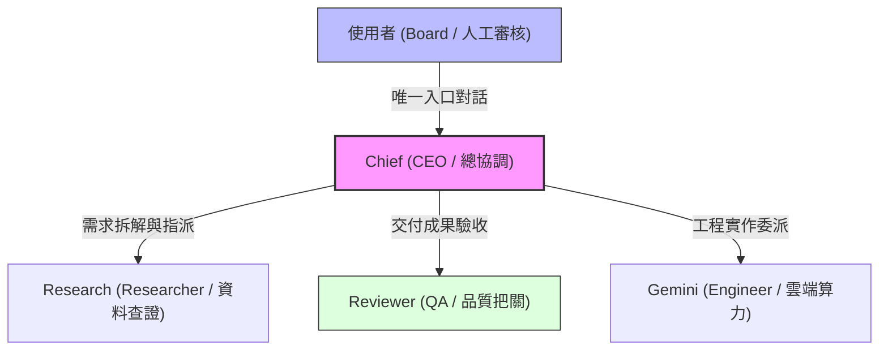

# Paperclip AI Chief｜雲端自主 Agent 團隊

> **專案定位**：零額外月費的雲端自主 AI 營運小組；以工程防護與實作留痕為核心，不為展示而重造管理平台。  
> **關鍵技術**：Paperclip、Codex CLI (codex_local / ChatGPT Plus)、Oracle Cloud Always Free (ARM64 Ampere A1)、Tailscale 私網防護。  
> **狀態**：本地端到端任務閉環與 Heartbeat 驗證通過；雲端網路就緒，VM 處於容量等待狀態（`OCI_CAPACITY_WAIT`）。

---

## 1. 核心痛點與架構目標

在企業或個人導入多代理（Multi-Agent）系統時，常見三大核心痛點：
1. **API 帳單失控與黑盒調用**：許多框架過度串接多個計費 API，缺少預算防護與 fail-closed 機制，稍微死循環便產生巨額帳單。
2. **依賴本機運行，關機即斷線**：本機跑 Agent 只要電腦睡眠或攜出即中斷工作，無法持續執行定時巡查或非同步任務。
3. **缺少嚴謹的資料治理與審批邊界**：Agent 自由增生或未經授權存取機敏資料，缺乏原生的人工審查（Human-in-the-loop）防線。

### 本專案之解決方案
- **零額外月費目標**：利用既有 ChatGPT 訂閱之 Codex CLI 作為推論引擎，搭配 Oracle Cloud Always Free ARM64 (Ampere A1) 免費算力，實踐 NT\$0 增額運作。
- **單一人機入口與組織階層**：使用者只對接 **Chief (CEO)**；由 Chief 拆解目標、指派給專業 Agent（Research、Reviewer、Gemini），並透過原生看板與留言追蹤進度。
- **嚴格審批與私網防護**：
  - 開啟原生審批防線（`requireBoardApprovalForNewAgents: true`），新 Agent 增聘必須經由人工核准。
  - 雲端環境採用 **Tailscale 私網隧道**，公網完全封鎖 3100 埠與資料庫，達成零暴露面防禦。
  - 資源耗盡時採取 **fail-closed**，嚴禁自動改用計費服務或付費實例。

---

## 2. 組織架構與角色分工 (Org Chart)

- **Chief (`role: ceo`)**：負責統籌全域需求、分解任務、協調相依性、排程巡查與每日進度彙報。
- **Research (`role: researcher`)**：負責外部資訊檢索、一手資料交叉查證與產出事實報告。
- **Reviewer (`role: qa`)**：負責成果驗收、事實比對、格式規範與防回歸審查；未達標準則駁回修改。
- **Gemini (`role: engineer`)**：整合 Google AI Studio 算力資源，提供技術輔助與代碼轉化。

---

## 3. 端到端實作與真實驗證留痕

本專案拒絕「概念宣傳」，全數實作成效均具備真實系統留痕與驗證依據：

### A. 完整任務閉環驗證 (PAP-1 & PAP-2)
- **主 Issue**：`PAP-1` (ID: `2d400ff0-ff64-42d4-ae46-e04b54c6d1c6`)
- **子 Issue**：`PAP-2` (ID: `6101a2e9-7a32-4001-b570-d5f72b425cb4`)
- **執行流**：Chief 接收需求拆解 → 指派 Research 進行查證並提交產出 → 交由 Reviewer 依 Checklist 嚴格驗收 → Reviewer 判定通過後交付 Chief 完成結案歸檔。

### B. Codex CLI 原生 Heartbeat 執行
- **Run ID**：`a4bbe496-d080-4f4e-95a1-c918851bf0f3`
- **狀態**：`succeeded`
- **推論機制**：透過本機 ChatGPT Plus 之 Codex CLI 原生調用輸出，成功於 Paperclip 架構內完成自主週期心跳。

### C. Gemini Local Adapter 驗證
- **測試 Issue**：`PAP-4`
- **狀態**：Adapter 檢測回傳 `status: pass`，確認雙引擎（Codex + Gemini）可按需切換與協作。

---

## 4. 雲端部署規格與防護架構

所有雲端部署腳本與配置均收錄於 `deploy/oracle-always-free/`：

1. **容器編排 (`docker-compose.oracle-arm64.yml`)**：
   - 針對 ARM64 (Ampere A1) 架構最佳化。
   - 限制容器資源上限（`cpus: '2.0'`, `memory: 6144M`），防止單一程序失控耗盡主機。
   - 連接埠僅綁定本機環回介面 (`127.0.0.1:3100:3100`)。
2. **安全安裝腳本 (`install-oracle-vm.sh`)**：
   - 自動配置 UFW 防火牆，預設封鎖外部公網連線，僅放行 SSH 與 `tailscale0` 虛擬網卡。
   - 自動產生 64 位元安全隨機密鑰 (`BETTER_AUTH_SECRET`)。
3. **排程巡查規格 (`routine-0700-taipei.json`)**：
   - 每日台北時間 07:00 定時觸發 Chief 進行早會巡查，主動通報 `blocked` 與 `failed` 項目。
4. **安全備份 (`backup-db.sh`)**：
   - 每日自動封裝 SQLite/Postgres 資料，排除任何 `.env`、憑證金鑰或 OAuth Token，自動保留近 7 日循環覆蓋。

---

## 5. 誠實工程限制與現狀

1. **雲端 VM 容量等待 (`BLOCKED: OCI_CAPACITY_WAIT`)**：
   - 已完成專屬虛擬雲端網路 `paperclip-vcn` 與公開子網路建置（Tokyo `ap-tokyo-1` 區域）。
   - 在建立 Ampere A1 (ARM64) 執行個體時，因該區域免費額度處於高峰飽和狀態，觸發系統內建安全機制暫停重試，不擅自升級為付費實例，實踐零成本承諾。
2. **多 Agent 並行 SQLite 鎖保護**：
   - 初次並行調用曾觸發鎖定競爭警告；已在排程設定中將各 Agent 的喚醒時間錯開 5 秒以上防護。
3. **SharePoint 與外部權限整合**：
   - 本專案僅建立嚴謹的「資料分類（PUBLIC / INTERNAL / RESTRICTED）與交接規範」，**不宣稱**已完成真實企業 SharePoint 租戶之權限串接。
