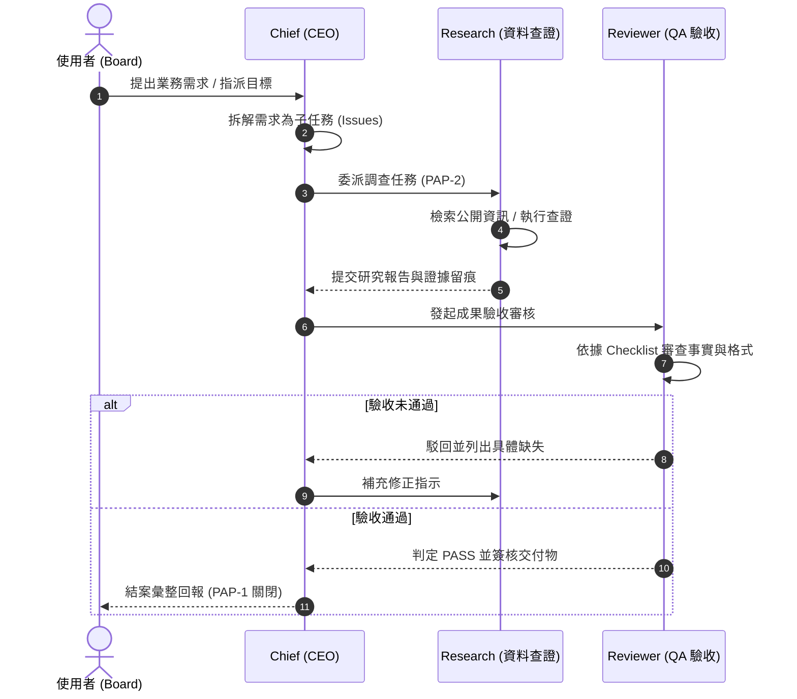

# WORKFLOW.md｜協作與任務流轉規範

本文件定義 Chief、Research、Reviewer 與 Gemini 之間的協作標準作業流程（SOP）。

## 階段說明
1. **需求拆解 (Decomposition)**：Chief 接收輸入後，建立主 Issue (`PAP-1`)，明確界定完成判準（Definition of Done）。
2. **研究查證 (Investigation)**：由 Research 依子 Issue (`PAP-2`) 進行針對性檢索，標註資料來源、日期與信心水準。
3. **品質審核 (Review & QA)**：Reviewer 檢視交付物是否具備可驗證事實、是否含未授權敏感資訊、結構是否符合規範。
4. **結案歸檔 (Completion)**：經 Reviewer 核可後，Chief 更新主 Issue 狀態為 Completed，留痕於系統活動日誌。
